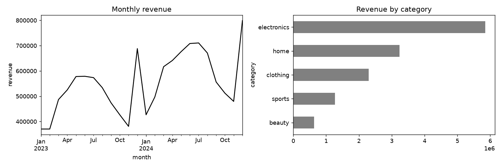

# ecommerce-sales-analysis

Sales KPI analysis for an online shop: revenue trends, category mix, Pareto concentration, discount effect.

## Task

Answer the questions a commercial team asks every month: how is revenue moving, which categories and channels carry it, and how concentrated is it on a few products or customers.

## Approach

- `src/data.py` generates two years of order lines with trend, yearly seasonality, a weekend effect and a heavy-tailed customer base.
- `src/core.py` computes monthly KPIs (revenue, orders, customers, average order value, month-over-month growth), category and channel summaries, weekday profile, discount effect and Pareto shares.
- `run.py` writes the charts and `reports/summary.json`.

## Results



- 119,629 orders, total revenue 13,279,586, average order value 111.06.
- Best month: 2024-12 (December seasonality plus growth).
- `electronics` brings 44% of revenue.
- The top 20% of products produce 44% of revenue; the top 20% of customers produce 61%.

## Run

```bash
pip install -r requirements.txt
python run.py      # generates data, runs the analysis, writes reports/
pytest             # unit tests
```

## Layout

```
src/data.py     data generation (fixed seed, no downloads)
src/core.py     analysis / model code
run.py          end-to-end script
tests/          unit tests
reports/        figures and summary.json produced by run.py
```

## Notes

The data is generated by `src/data.py` with a fixed random seed, so the numbers above are reproducible. It is synthetic: it is meant to show the method, and results on real data will differ.

Stack: pandas, numpy, matplotlib.
